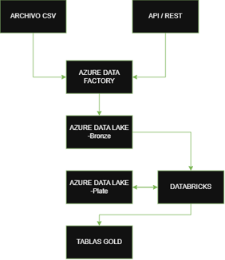
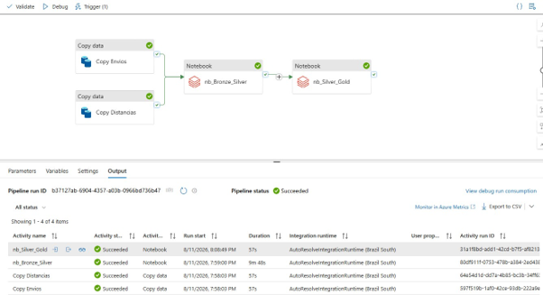
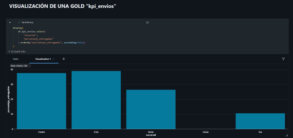

# Azure Logistics Data Pipeline

🇪🇸 [Leer en español](README.es.md)

An end-to-end data engineering project built for the **Data Engineering Diploma (ICARO)**. It simulates the data workflow of a logistics company: ingesting shipment data from two sources, validating it, and producing analytical tables ready for business reporting.

> **Project status:** completed as an academic project. The Azure resources were created on a free subscription that has since expired, so the pipeline can no longer be run. This repository documents the implementation: code, architecture, design decisions and results.

---

## Business case

A company that ships packages between Argentine cities needs to understand:

- How its shipments behave (delivered, in transit, delayed, cancelled)
- How each branch performs
- What the different routes look like (distance, duration, fuel cost, tolls)

## Architecture



```
CSV (shipments) ──┐
                  ├─► Azure Data Factory ─► Landing ─► Bronze ─► Databricks ─► Silver ─► Quality checks ─► Gold ─► Visualization
JSON (distances) ─┘                                              (PySpark)                                (Delta)
```

| Layer | Content |
|-------|---------|
| **Landing** | Source files exactly as received |
| **Bronze** | Data ingested by Data Factory, separated by topic (`envios/`, `distancias/`) |
| **Silver** | Cleaned data, shipments joined with route information (Delta) |
| **Gold** | Aggregated, business-oriented tables (Delta) |

## Technologies

| Component | Purpose |
|-----------|---------|
| Azure Data Factory | Ingestion and orchestration (Copy Data activities, Schedule Trigger) |
| Azure Data Lake Storage Gen2 | Storage for all layers |
| Azure Databricks | Processing and transformation |
| PySpark | Cleaning, validation, joins and aggregations |
| Delta Lake | Storage format for Silver and Gold |
| Managed Identity + Unity Catalog | Secure access between services (no storage keys in the pipeline) |

## Data sources

| Source | Format | Main fields |
|--------|--------|-------------|
| Shipments | CSV (`;` delimiter) | `id_envio`, `fecha`, `sucursal`, `origen`, `destino`, `peso_kg`, `cliente`, `estado` |
| Routes ("API") | JSON | `origen`, `destino`, `distancia_km`, `duracion_min`, `peajes`, `costo_combustible_estimado` |

The data is **synthetic** and intentionally includes invalid records to demonstrate the data quality checks. Sample files are in [`/data`](data/).

## Orchestration (Azure Data Factory)



1. **Copy Envios** and **Copy Distancias** run in parallel and move the files Landing → Bronze.
2. **nb_Bronze_Silver** runs only if both copies succeed.
3. **nb_Silver_Gold** runs only if the previous notebook succeeds.

A Schedule Trigger (`tr_diario`) runs the whole pipeline once a day.

**Security:** Data Factory authenticates against Databricks and the Data Lake through a **Managed Identity**, granted `READ FILES` / `WRITE FILES` on a Unity Catalog External Location. No personal credentials or storage account keys are used in the automated run.

The exported pipeline and trigger definitions are in [`/adf`](adf/).

## Notebooks

**`nb_bronze_a_silver.ipynb`**
- Reads the shipments CSV and the distances JSON from Bronze
- Data profiling: row count, duplicate IDs, nulls per column, distinct values in `estado`
- Cleaning: drops rows with nulls in `fecha`, `origen`, `destino`, `peso_kg` and duplicates by `id_envio`
- Left join of shipments with route data on `origen` and `destino`
- Writes the result to Silver in Delta format

**`nb_silver_to_gold.ipynb`**
- Reads Silver
- Data quality checks using helper flag columns
- Splits valid and invalid records
- Builds the three Gold tables with `groupBy` aggregations and writes them in Delta format

## Data quality

| Check | Rule |
|-------|------|
| `valida_id` | `id_envio` is not null |
| `valida_peso` | `peso_kg > 0` |
| `valida_estado` | `estado` is one of: Entregado, En tránsito, Demorado, Cancelado |
| `valida_distancia` | `distancia_km > 0` |

| Records evaluated | Rejected | Valid |
|:-:|:-:|:-:|
| 89 | 2 | **87** |

The two rejected records (`id_envio` 91 and 45) had `peso_kg = -5`. They are excluded before the Gold layer so they cannot distort the metrics.

## Gold tables

| Table | Grain | Metrics |
|-------|-------|---------|
| `envios_por_sucursal` | Branch | Total shipments, count by status, average weight and distance |
| `kpi_envios` | Branch | Same as above plus total distance, average duration, fuel cost (total and average), total tolls and **delivery rate (%)** |
| `rutas` | Origin → Destination | Shipment count, average distance and duration, fuel cost, tolls, average weight |

Example output of `envios_por_sucursal`:

| sucursal | total_envios | entregados | en_transito | demorados | cancelados |
|----------|:-:|:-:|:-:|:-:|:-:|
| Sur | 19 | 2 | 4 | 4 | 9 |
| Oeste | 15 | 0 | 6 | 4 | 5 |
| Este | 18 | 7 | 6 | 4 | 1 |
| Norte | 19 | 5 | 9 | 2 | 3 |
| Centro | 16 | 6 | 2 | 4 | 4 |

## Visualization

A bar chart built in Databricks on top of `kpi_envios`, showing the delivery rate per branch.



In this dataset, Este (38.89%) and Centro (37.50%) have the highest delivery rates, Norte reaches 26.32%, Sur 10.53%, and Oeste has no delivered shipments.

## Repository structure

```
azure-logistics-data-pipeline/
├── README.md
├── README.es.md
├── notebooks/
│   ├── nb_bronze_a_silver.ipynb
│   └── nb_silver_to_gold.ipynb
├── data/
│   ├── envios_logistica.csv
│   └── api_distancias.json
├── adf/
│   ├── pl_ingesta_bronze.json
│   └── tr_diario.json
└── docs/
    └── img/
```

## Challenges and lessons learned

- Getting storage paths and Data Factory datasets right (ADF must be given the exact file name, otherwise it can treat a folder as a file).
- Moving from a manual storage-key connection to **Managed Identity + Unity Catalog** when automating: workspace, cluster and External Location permissions had to be configured.
- Validating data quality **before** aggregating, so bad records never reach the analytical layer.

## Future improvements

- Store rejected records in a dedicated table for traceability
- Automated tests for the data quality rules
- Monitoring and failure alerts
- Event-based triggers (run when a new file arrives)
- Incremental loads and optimization for larger volumes
- More data sources and business indicators

## Author

**Benjamín Briolini** · [GitHub](https://github.com/Benjabrio)

Data Engineering Diploma · ICARO
